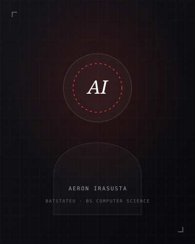

# Aeron Irasusta — Software Engineer Portfolio

> Editorial, high-performance developer portfolio inspired by the **Reelhouse Studios** aesthetic. Engineered with semantic HTML5, modern CSS3, and zero-dependency vanilla JavaScript.



---

## Overview

- **Author**: Aeron Irasusta
- **Role**: Software Engineer
- **Focus**: AI Automation · Full-Stack Web Development · UI/UX · Defensive Cybersecurity
- **Institution**: Batangas State University - The National Engineering University (BatStateU - The NEU)
- **Degree**: Bachelor of Science in Computer Science (BS CS)
- **Live Links**:
  - **GitHub**: [github.com/aeronautic005](https://github.com/aeronautic005)
  - **LinkedIn**: [linkedin.com/in/irasustaaeron](https://www.linkedin.com/in/irasustaaeron/)
  - **Email**: [atsusariaeron05@gmail.com](mailto:atsusariaeron05@gmail.com)
  - **Contact**: +63 960 264 7379 / 09602647379

---

## Design System & Highlights

- **Typographic Trio**:
  - *Cormorant Garamond* (Editorial serif italic headlines)
  - *Manrope* (Contemporary geometric sans UI)
  - *IBM Plex Mono* (Technical monospaced metadata, timecode cues, and indices)
- **Palette**: Deep matte obsidian (`#0a0a0c`), surface charcoal (`#121216`), and signature **Crimson Red** accents (`#e53835`).
- **Studio Details**:
  - Persistent desktop left rail navigation with live green availability beacon.
  - Interactive viewfinder corner brackets (`┌ ┘`) and real-time studio timecode ticker (`[ 00 : 00 : 00 ]`).
  - Interactive credential preview modal for the verified **AppBuilders PH Hackathon** milestone.
  - Fully responsive slide-out drawer navigation for tablet and mobile devices.

---

## Repository Structure

```text
├── index.html              # Semantic markup and complete content blueprint
├── style.css               # Editorial CSS design system, typography, and responsive grid
├── script.js               # IntersectionObserver scroll spy, mobile drawer, and modal
├── assets/
│   └── images/
│       ├── profile.png     # Personal photo
│       └── profile.svg     # Technical monogram vector graphic
└── README.md               # Repository documentation
```

---

## Getting Started Locally

1. Clone the repository:
   ```bash
   git clone https://github.com/aeronautic005/YOUR-REPO-NAME.git
   ```
2. Open `index.html` in any web browser:
   - Double-click `index.html`, or
   - Use VS Code Live Server extension.
